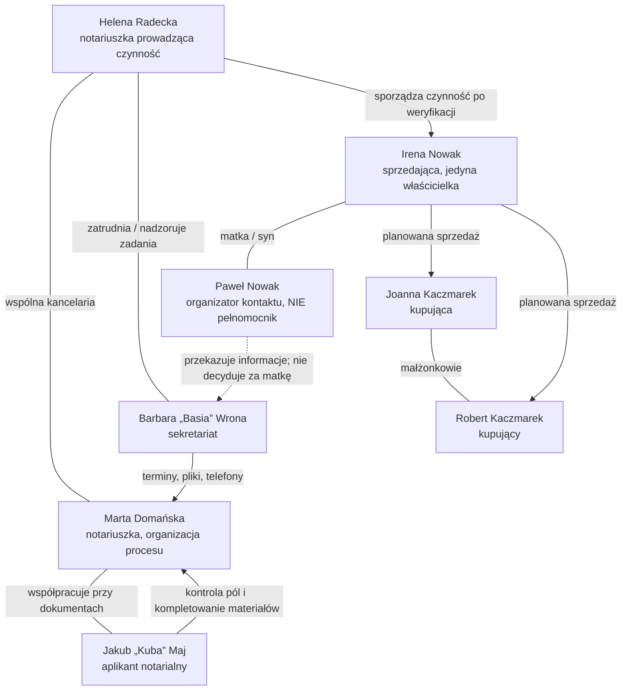

# KANCELARIA POD SIÓDEMKĄ
## SEZON 1 — „NIE WSZYSTKO JEST W PAPIERACH”
### Pełna biblia intrygi, relacji, dokumentów i motywacji

**Wersja kanoniczna: 12 listopada 2026 r.**  
**Status:** koncepcja dla zespołu produkcyjnego, zawiera zakończenie sezonu i wszystkie zwroty akcji. **Nie stanowi opinii prawnej.** Zanim powstanie jakikolwiek odcinek, konieczna jest autoryzacja czynnego notariusza oraz weryfikacja funkcjonalności w aktualnym środowisku produktu.

> **Idea:** Największym przeciwnikiem bohaterów nie jest technologia, ani „zły klient”. Jest nim pośpiech, fragmentacja informacji i skala równoległych obowiązków. NotarAI porządkuje dane, dokumenty, terminy oraz etapy sporządzania projektów. Notariusz zachowuje obowiązki, kontrolę, ocenę prawną i odpowiedzialność.

---

# 0. SZYBKA ODPOWIEDŹ: O CZYM JEST CAŁA INTRYGA?

W kancelarii prowadzonej wspólnie przez notariuszki **Helenę Radecką** i **Martę Domańską** przygotowywana jest sprzedaż mieszkania należącego do **Ireny Nowak**. Termin wyznaczono na wtorek, na godzinę 11:30. Dokumenty zebrano w kilku miejscach; podstawowe materiały do projektu odczytano w piątek. W poniedziałek rano sekretariat, aplikant i notariuszki próbują jednocześnie obsłużyć telefony, wizyty, dodatkowe dokumenty i kolejne sprawy.

Irena jest **jedyną właścicielką mieszkania**. Jej syn **Paweł Nowak** nie ma udziału we własności i **nie jest jej pełnomocnikiem**. Mimo tego przez ostatnie tygodnie organizował większość kontaktów z kupującymi: małżeństwem **Joanną i Robertem Kaczmarkami**. Paweł chce, by matka przeprowadziła się do dostępniejszego mieszkania bez schodów. Kupujący liczą na szybkie otrzymanie kluczy, bo kończy im się najem.

W ich wiadomościach od tygodni krąży data **1 grudnia** jako termin wydania lokalu. Irena rozumie jednak, że ma oddać klucze dopiero **15 stycznia**. Nie chce zerwać transakcji, ale potrzebuje więcej czasu, żeby przenieść się spokojnie i podjąć decyzję bez presji. Syn błędnie założył, że jego matka ostatecznie zaakceptowała wcześniejszy termin; nie potwierdził tego z nią wprost. Kupujący, dla których data jest istotna, traktują ją już jak uzgodnioną.

**Oto główna tajemnica:** gdy w pilocie Irena prosi o rozmowę „bez syna”, widz może podejrzewać przemoc, wyłudzenie, problem ze zdolnością do czynności prawnych albo tajny spór o własność. Żadna z tych sensacyjnych hipotez **nie okazuje się prawdą**. Irena chce po prostu być wysłuchana jako sprzedająca i właścicielka; boi się zranić Pawła, który z troski o nią włożył dużo pracy i własnych pieniędzy w znalezienie następnego mieszkania.

W miarę rozwoju historii wychodzi na jaw, że **Paweł zarezerwował z własnych środków mieszkanie na parterze**, licząc na szybką przeprowadzkę matki. Nie działa dla własnego zysku, ale jego życzliwa nadgorliwość i niewyjaśnione założenia wywołały zawodową lawinę: błędne dane do projektu, sprzeczne oczekiwania co do wydania lokalu i presję terminu. Kancelaria zatrzymuje przygotowania do planowanego aktu do chwili wyjaśnienia woli stron i warunków transakcji.

**Finał:** Irena sama potwierdza, że chce sprzedać mieszkanie, ale na uzgodnionych przez nią warunkach. Kupujący organizują przedłużenie najmu i akceptują termin wydania 15 stycznia. Sprzedaż dochodzi do skutku dopiero po uzupełnieniu dokumentów, uzgodnieniu warunków, przygotowaniu projektu i czynnościach należących do notariusza. Paweł przeprasza za pośpiech; Irena nie musi wybierać między autonomią a bliskością syna. Zespół kancelarii ma za sobą wiele prac, których wcześniej nie dałoby się łatwo prześledzić w jednym miejscu.

**Puenta sezonu:** komputer doskonale pomaga ustalić, jakie dokumenty, informacje i decyzje jeszcze są potrzebne. Nie może zastąpić rozmowy, podczas której notariuszka przekonuje się, jaka jest rzeczywista wola stron.

---

# 1. KANON: FAKTY, KTÓRYCH NIE ZMIENIAMY MIĘDZY ODCINKAMI

1. **Kancelaria:** „Kancelaria pod Siódemką” to nazwa serialowa; formalnie wspólna kancelaria dwóch notariuszek, prowadzona w formule dopuszczalnej przez art. 4 § 3 Prawa o notariacie (szczegóły ustrojowe wymagają ostatecznej kontroli). Każda notariuszka dokonuje własnych czynności we własnym imieniu. **Helena odpowiada za główną czynność Ireny**; Marta wspiera organizację i prowadzi inne czynności jako notariuszka, nie jako podwładna Heleny wykonująca jej kompetencje.
2. **Adres:** „pod siódemką” jest nazwą miejsca/serialu, nie numerem repertorium. Miejscowość i autentyczny adres kancelarii pozostają nieokreślone; plany zdjęciowe nie ujawniają przypadkowych prawdziwych danych.
3. **Główna nieruchomość:** mieszkanie stanowiące odrębną własność, około **56 m²**, w budynku z utrudnionym dostępem (schody). Dział II księgi wieczystej w fikcyjnej teczce wskazuje Irenę Nowak jako właścicielkę. Na potrzeby głównego wątku **nie ma aktywnego sporu o własność ani starej hipoteki**; to celowe uproszczenie, żeby konflikt był o wolę i warunki transakcji, a nie o osiem niepowiązanych wad prawnych.
4. **Cena robocza:** **640 000 zł**. Liczba jest fikcyjna; pojawia się konsekwentnie we wszystkich rekwizytach. Sposób zapłaty (środki własne + finansowanie bankowe kupujących) musi zostać rzeczywiście uzgodniony i zaakceptowany przy przygotowaniu aktu; nie pokazujemy fikcyjnego potwierdzenia zapłaty.
5. **Pierwotny termin podpisania:** wtorek po pilocie, godz. 11:30. To **termin planowany**, nie prawnie gwarantowany. Gdy wychodzą na jaw rozbieżności, czynność nie następuje tego dnia.
6. **Istota niezgodności:** data wydania lokalu i rzeczywisty zakres uzgodnienia między stronami. **1 grudnia** to oczekiwanie kupujących odczytane przez Pawła jako obowiązująca wersja; **15 stycznia** to termin, który odpowiada Irenie i ostatecznie zostaje uzgodniony.
7. **Własność a wydanie:** **własność nieruchomości przechodzi zgodnie z prawnie skuteczną umową przenoszącą, nie „dopiero przy przekazaniu kluczy”**. Termin wydania lokalu jest odrębnym zagadnieniem. Nie wolno pokazywać sprzedającej jako właścicielki aż do stycznia, jeżeli wcześniej doszło do skutecznego przeniesienia własności.
8. **Paweł** nie ma własnego prawa do decydowania za Irenę, nie występuje w akcie jako pełnomocnik i nie podaje się za jedynego właściciela. Uczestniczy w korespondencji jako osoba pomagająca matce. **Jego wyjaśnienia nie zastępują woli Ireny.**
9. **Nie ma czarnego charakteru.** Bohaterowie mają niekompletne informacje, odmienne priorytety i uzasadnioną presję czasu. Nie ma podrabiania podpisów, celowej podmiany księgi wieczystej, fałszywego trafienia w KRZ z powodu samego nazwiska ani przestępstwa odkrywanego przez AI.
10. **NotarAI:** sprawa może mieć kalendarz, pliki, zdjęcia z telefonu, odczyt, pola wymagające uwagi, projekt aktu, własny styl i moduły rejestrów. Automatyczne dopasowywanie przychodzącego maila, porównanie wersji KW, globalna tablica zadań i pełne głosowe sterowanie wskazanym komputerem **nie są przedstawiane jako wdrożone bez wcześniejszej demonstracji end-to-end**.
11. **Projekt to nie akt dokonany.** NotarAI przygotowuje projekt do oceny. Sformułowania „akt podpisany”, „wniosek wysłany” czy „wpis dokonany” dotyczą wyłącznie rzeczywistych działań wykonanych przez uprawnione osoby po wymaganych formalnościach.
12. **Pilota zachowujemy:** poniedziałek, 8:57; Basia, Marta, Kuba, Helena; materiały do pierwszego odczytu były przygotowane w piątek; Paweł przynosi dodatkowy dokument, Basia fotografuje go telefonem; Helena przegląda projekt; końcówka: Irena prosi o rozmowę bez syna.

---

# 2. KTO JEST KIM? PEŁNA MAPA POSTACI

## 2.1 Schemat relacji



**Uwaga produkcyjna:** graf nie oznacza, że każda osoba uzyskuje dostęp do wszystkich danych; to mapa narracyjna, nie diagram uprawnień systemowych.

## 2.2 Helena Radecka — 56 lat

- **Kim jest:** doświadczona notariuszka; współprowadzi kancelarię z Martą. Przeprowadza czynność dotyczącą sprzedaży mieszkania Ireny.
- **Czego chce jawnie:** projektu sporządzonego w zgodzie z dokumentami i standardami kancelarii; wyjaśnienia rozbieżności przed spotkaniem stron.
- **Czego chce naprawdę:** mieć pewność, że mimo tempa i liczby obowiązków nie traci możliwości spokojnego wysłuchania ludzi i dokonania prawidłowej oceny.
- **Największy lęk:** ktoś uzna niezweryfikowane dane z wydruku albo słowa Pawła za ustaloną wolę właścicielki.
- **Wada charakteru:** bywa przesadnie kontrolująca i trudno jej delegować rutynowe przygotowanie.
- **Atut:** bardzo dobrze odróżnia niekompletną informację od prawnej konkluzji.
- **Łuk sezonu:** od przeświadczenia „muszę wszystkiego dopilnować osobiście” do „widzę całość, więc mogę skupić się na ocenie i rozmowie”.
- **Relacja z Martą:** wzajemny szacunek, miejscami napięcie dotyczące standardu i tempa wdrażania technologii. Nie jest antytechnologiczna z zasady; sprzeciwia się bezkrytycznemu automatyzmowi.
- **Zasada pisarska:** nigdy nie popełnia rażącego błędu prawnego tylko po to, by AI mogło ją poprawić.

## 2.3 Marta Domańska — 38 lat

- **Kim jest:** druga notariuszka we wspólnej kancelarii; rozumie technologię i zna rzemiosło notarialne.
- **Czego chce jawnie:** przygotować projekt sprzedaży Ireny na czas, uporządkować współpracę z zespołem.
- **Czego chce naprawdę:** udowodnić, że lepszy przepływ informacji wzmacnia standard zawodowy zamiast go rozmiękczać.
- **Lęk:** jeśli za bardzo obieca możliwości programu, Helena przestanie jej ufać, a zespół potraktuje wynik AI jak dokument gotowy do podpisu.
- **Wada:** czasem za szybko zakłada, że proces jest już „załatwiony”, bo system wygenerował wynik.
- **Atut:** potrafi dobrze tłumaczyć, gdzie narzędzie jest pomocne, a gdzie należy przerwać i wyjaśnić sprawę z człowiekiem.
- **Łuk:** od entuzjastki produktu do wiarygodnej liderki wdrożenia, która potrafi mówić również o ograniczeniach.
- **Jej „Komputerku…”:** naturalny nawyk zwracania się do narzędzia; **obecnie w filmie wsparty widoczną interakcją w UI**, bez niewdrożonego hasła wybudzającego.

## 2.4 Barbara „Basia” Wrona — 51 lat

- **Kim jest:** kieruje bieżącą obsługą recepcji i obiegiem informacji; zna klientów, ich terminy, adresy korespondencyjne i zwyczaje zespołu.
- **Czego chce jawnie:** żeby żadna osoba nie czekała bez informacji, a żaden dokument nie zginął.
- **Czego chce naprawdę:** czuć, że jej kompetencja — pamięć o ludziach, dyskrecja, organizacja — pozostaje niezbędna mimo automatyzacji.
- **Lęk:** oprogramowanie zastąpi ją „w pamiętaniu wszystkiego”.
- **Wada:** brała na siebie za dużo i stała się centralnym punktem wszystkich pytań.
- **Atut:** jako pierwsza zauważa, że Irena nie chce rozmawiać przy synu; nie insynuuje winy, tylko dyskretnie przekazuje informację Helenie.
- **Łuk:** od „wszyscy pytają Basię” do „Basia koordynuje pracę, bo informacje są we wspólnym systemie”.

## 2.5 Jakub „Kuba” Maj — 28 lat

- **Kim jest:** aplikant notarialny. Wykonuje prace przygotowawcze pod nadzorem właściwych osób; **nie przypisujemy mu kompetencji notariusza**.
- **Czego chce:** awansować w oczach Heleny; samodzielnie radzić sobie z trudniejszym materiałem.
- **Lęk:** że będzie oceniany jako ten, który „zawsze czegoś nie wie”.
- **Wada:** czasami woli dopytać Basię, niż najpierw zajrzeć do akt sprawy i sprawdzić materiał źródłowy.
- **Atut:** dostrzega szczegóły niepasujące do ustaleń oraz uczciwie przyznaje się do błędnego założenia.
- **Łuk:** od pośpiesznego wykonywania poleceń do zawodowego nawyku dokumentowania, skąd pochodzi każda informacja.

## 2.6 Irena Nowak — 73 lata

- **Kim jest:** klientka, wdowa, jedyna właścicielka mieszkania od 2009 r. Chce sprzedać lokal i przeprowadzić się do mniejszego mieszkania na parterze, bliżej przyjaciółki oraz usług.
- **Co mówi na początku:** chce sprzedać nieruchomość; pozwala Pawłowi pomagać w formalnościach.
- **Czego nie mówi od razu:** nie zgodziła się na wydanie kluczy 1 grudnia. Czuje, że wszyscy planują jej życie szybciej, niż ona sama chciałaby się przeprowadzić.
- **Dlaczego prosi o rozmowę bez syna:** obawia się, że jego poświęcenie i wydatki sprawią, iż nie będzie umiała swobodnie zakwestionować narzuconego tempa.
- **Czego chce naprawdę:** podjąć własną, świadomą decyzję — sprzedać, ale zachować czas na spokojną wyprowadzkę i ustalić dokładnie datę, rozliczenia oraz warunki wydania.
- **Czego NIE ma w fabule:** automatycznego przypisania jej braku zdolności do czynności prawnych, depresji, demencji ani „nieporadności” wyłącznie z powodu wieku. Jej wahanie jest zwykłą i w pełni zrozumiałą preferencją życiową.
- **Łuk:** od pozwalania innym mówić za siebie do jasnego artykułowania własnych warunków.

## 2.7 Paweł Nowak — 45 lat

- **Kim jest:** syn Ireny, nie jest współwłaścicielem mieszkania, nie dysponuje pełnomocnictwem do jego sprzedaży.
- **Co robi:** ustala terminy, przesyła dokumenty, kontaktuje się z kupującymi; dostarcza zaświadczenie od zarządcy budynku na początku pierwszego odcinka.
- **Czego chce jawnie:** żeby sprzedaż doszła do skutku szybko, zanim przepadnie możliwość zakupu dogodnego mieszkania dla matki.
- **Co ukrywa — ale nie jest to przestępstwo:** z własnych oszczędności zapłacił opłatę rezerwacyjną dotyczącą innego mieszkania, nie uzgadniając z Ireną wszystkich konsekwencji organizacyjnych. Nie chce jej martwić ani przyznać, że zbyt wcześnie obiecał kupującym wydanie lokalu.
- **Czego chce naprawdę:** żeby matka mieszkała wygodniej i bezpieczniej; wspomnienie jej niedawnego potknięcia na schodach przyspieszyło jego działania. Nie naciska po to, aby zagarnąć środki ze sprzedaży.
- **Wada:** myli troskę z podejmowaniem decyzji za kogoś, komu chce pomóc.
- **Łuk:** od prowadzenia rozmów *w imieniu matki* bez umocowania do towarzyszenia jej w decyzjach, które podejmuje sama.

## 2.8 Joanna Kaczmarek — 34 lata

- **Kim jest:** kupująca; razem z mężem Robertem zamierza nabyć mieszkanie na własne potrzeby. Sposób nabycia do wspólności majątkowej i status małżeństwa muszą wynikać z rzeczywistych danych przedstawionych w demonstracyjnej teczce.
- **Czego chce:** mieć wyjaśniony termin wydania i termin płatności, bo zbliża się koniec ich aktualnego najmu.
- **Lęk:** że wydłużenie terminu wydania pozbawi rodzinę pewnego miejsca zamieszkania.
- **Atut:** kiedy rozumie, że 1 grudnia nigdy nie był bezspornie uzgodniony z właścicielką, podejmuje rozmowę o alternatywie zamiast szukać „winnego”.

## 2.9 Robert Kaczmarek — 36 lat

- **Kim jest:** mąż Joanny i drugi kupujący.
- **Czego chce:** zamknąć finansowanie transakcji i mieć komplet informacji dla banku.
- **Lęk:** że przesunięcie terminu skomplikuje dokumenty kredytowe oraz ich plan przeprowadzki.
- **Wada:** formułuje w mailach stanowcze terminy, zanim strony potwierdzą je ze sprzedającą.
- **Atut:** w finale akceptuje praktyczny kompromis: właścicielka otrzymuje czas na przeprowadzkę, a kupujący zabezpieczają własne potrzeby przez zmianę ustaleń najmu i dobrze opisane zobowiązania dotyczące wydania lokalu.

## 2.10 Postacie epizodyczne

- **Pani Borowska:** klientka w odrębnej sprawie dotyczącej nieruchomości. Jej KW pozwala pokazać problem nowej wzmianki i ostrożność w interpretacji zmian. Ta sprawa **nie jest powiązana prawnie ani rodzinnie z Ireną**.
- **Zarządca / przedstawiciel wspólnoty:** wystawia uzupełniający dokument o rozliczeniach eksploatacyjnych. Nie jest stroną sprzedaży.
- **Pracownik banku kupujących:** udziela informacji o dokumentacji finansowania za pośrednictwem stron; bank nie wydaje „zgody na własność” i nie zastępuje decyzji notariusza.
- **Inni klienci kancelarii:** osoby oczekujące na poświadczenia, darowizny i pełnomocnictwa. Ich obecność buduje wiarygodne przeciążenie recepcji; nie wszyscy są w głównej intrydze.

---

# 3. CO KAŻDY WIE? MAPA INFORMACJI, MILCZENIA I NIEPOROZUMIEŃ

| Osoba | Co uznaje za pewne na początku | Co naprawdę wie | Czego jeszcze nie wie |
|---|---|---|---|
| Irena | Chce sprzedać mieszkanie, ale bez pośpiechu | Nie zaakceptowała 1 grudnia; chce oddać klucze 15 stycznia | Paweł zapłacił już opłatę rezerwacyjną za inne mieszkanie |
| Paweł | 1 grudnia jest zapewne do zaakceptowania | Matka chce przeprowadzki i martwi się schodami; kupujący liczą na szybkie klucze | Jak mocno matce zależy na czasie i dlaczego boi się go zawieść |
| Joanna | Wstępne ustalenia przewidują wydanie 1 grudnia | Ten termin znalazł się w korespondencji od Pawła | Że sprzedająca nie potwierdziła go osobiście |
| Robert | Terminy trzeba zamknąć przez wzgląd na najem i bank | Wysłał swoją wersję ustaleń mailem | Że jego mail uznano za wspólne potwierdzenie, choć nim nie był |
| Basia | W teczce jest zapisany termin na wtorek | Wpływają dokumenty, telefonów jest dużo, Irena chce rozmawiać bez syna | Jaki jest powód prośby Ireny |
| Kuba | Projekt można redagować z dostępnych materiałów | Nie wszystkie pola mają potwierdzenie, część danych pochodzi od syna | Które ustalenia Irena rzeczywiście akceptuje |
| Marta | Proces jest przygotowany do etapu weryfikacji | Można przygotować projekt, ale nie wszystkie dane są rozstrzygnięte | Co Irena powie Helenie w rozmowie osobistej |
| Helena | Termin jest wyznaczony, ale akt nie musi zostać dokonany | Wola i zrozumienie czynności wymagają wyjaśnienia u właściwych stron | Jakie prywatne zobowiązanie przyspiesza Pawła |
| Widz | Może podejrzewać konflikt rodzinny albo naciski | Widzi tylko urywki rozmów i sprzeczne sygnały | Nie zna faktycznych motywacji żadnej strony |

**Rygor fabularny:** w scenach nie wolno pokazywać prywatnej wiedzy Pawła jako faktu oficjalnie ustalonego przez notariusza. Dokument „informacja od syna” musi być opisany inaczej niż „oświadczenie sprzedającej” albo „ustalenie wszystkich stron”.

---

# 4. JAKĄ TRANSAKCJĘ STRONY PRÓBUJĄ ZAWARĆ?

## 4.1 Przedmiot

- **Rodzaj:** sprzedaż lokalu mieszkalnego stanowiącego odrębną nieruchomość.
- **Powierzchnia użytkowa w rekwizytach:** 56,40 m².
- **Właścicielka:** Irena Nowak; źródło nabycia — akt notarialny sprzedaży z 2009 r., kiedy była już wdową. W tej wersji kanonu nie ma sporu o majątek wspólny ani o skutki dziedziczenia; zespół powinien przygotować fikcyjne źródło własności zgodne z zapisem KW.
- **Księga wieczysta:** wyłącznie **fikcyjny numer demonstracyjny**, niewskazujący rzeczywistej księgi; żadnej przypadkowo istniejącej KW. Dział I-O odpowiada opisowi lokalu; dział I-Sp zawiera udział w nieruchomości wspólnej, opisany zgodnie z fikcyjną dokumentacją; dział II — Irena; w głównej sprawie działy III i IV nie zawierają aktywnych obciążeń istotnych dla fabuły.
- **Cena:** 640 000 zł — punkt wyjścia do finalnej wersji ustaleń, nie obietnica ceny rynkowej.

## 4.2 Strony i ich udział

- **Sprzedająca:** Irena Nowak **osobiście**; nie działa przez Pawła. Jej tożsamość i wymagane elementy czynności weryfikuje notariuszka zgodnie z właściwą procedurą.
- **Kupujący:** Joanna i Robert Kaczmarkowie **osobiście**, po ustaleniu ich sytuacji majątkowej oraz sposobu nabycia.
- **Paweł:** organizator, osoba kontaktowa, **nie jest stroną aktu ani zastępczym głosem matki**.
- **Notariuszka:** Helena Radecka. Przygotowuje i przeprowadza czynność po uzgodnieniu warunków; Marta jako druga notariuszka współpracuje operacyjnie, nie podpisuje aktu „za Helenę”.

## 4.3 Punkty, które muszą uzgodnić strony

1. Jaka jest cena i jednoznaczny mechanizm zapłaty, także w zakresie udziału środków z kredytu kupujących.
2. Kiedy i w jaki sposób następuje **wydanie lokalu** oraz kto ponosi koszty związane z zajmowaniem go do tej daty.
3. Czy lokal ma być wydany opróżniony, co stanie się z wyposażeniem i kto organizuje przekazanie kluczy.
4. Jak rozliczyć opłaty eksploatacyjne za okres między podpisaniem umowy a wydaniem lokalu.
5. Jakie są dokumenty wymagane prawnie w konkretnym stanie faktycznym, jakie wymagania wynikają z banku, a które zaświadczenia zamówiono wyłącznie dla komfortu kupujących.
6. Jak udokumentować fakt, że Irena samodzielnie rozumie i akceptuje terminy oraz ekonomiczne skutki transakcji.

## 4.4 Czego nie wolno pomylić

- **Umowa sprzedaży / przeniesienie własności** to nie to samo co fizyczne wydanie lokalu i kluczy.
- **Robocza notatka Pawła** to nie jest umowa sprzedającej ani jej pełnomocnictwo.
- **Mail kupujących z propozycją terminu** to nie jest dowód, że Irena zaakceptowała termin.
- **Wygenerowany Word** to projekt, nie dokonana czynność notarialna.
- **Kalkulacja ceny/opłat czy wynik checkera** to materiał informacyjny, nie zaświadczenie urzędu, postanowienie sądu ani merytoryczna decyzja notariusza.
- **Nieodnotowany/niepotwierdzony brak wpisu** nie oznacza, że „nieruchomość jest na pewno bez jakiegokolwiek ryzyka”.

---

# 5. DOKUMENTY — PEŁNA LISTA REKWIZYTÓW GŁÓWNEJ SPRAWY

Wszystkie pliki są syntetyczne, nie zawierają prawdziwych numerów PESEL, KW ani dokumentów tożsamości. Nazwy plików i identyfikatory są **kanonem produkcyjnym**, żeby sceny, mailing i materiał demo nie rozjechały się między odcinkami.

**Identyfikator sprawy w serii (produkcyjny, niekoniecznie dokładna forma pola w interfejsie):** `S-041-2026`  
**Nazwa w teczce:** `NOWAK — KACZMAREK / sprzedaż lokalu`  
**Wersja warunków transakcji:** `T1` (niepotwierdzona) → `T2` (zweryfikowana i zaakceptowana przez strony).

| ID | Dokument / plik filmowy | Kto dostarcza | Znaczenie i użycie fabularne | Status / uwaga |
|---|---|---|---|---|
| D01 | `2009_akt_nabycia_IRENA_demo.pdf` — fikcyjny wcześniejszy akt nabycia | Irena / Paweł jako przekazujący | Pokazuje tytuł nabycia; dane porównywane z KW i wzorem | Dokument źródłowy do analizy, nie automatyczna gwarancja stanu |
| D02 | `KW_stan_roboczy_13-11_demo.pdf` | Kancelaria (poprzedni odczyt) | Punkt odniesienia do przygotowania projektu w piątek | Wymaga ponownego sprawdzenia aktualności przed czynnością |
| D03 | `KW_stan_aktualny_demo.pdf` / plik wyniku EKW | Kancelaria | Aktualne informacje o lokalu i właścicielu | Źródło, data pobrania i kompletność działów obowiązkowo widoczne |
| D04 | `foto_zaswiadczenia_zarzadcy_demo.jpg` | Paweł przekazuje papier, Basia wykonuje zdjęcie | Fotografia dokumentu D08 dotyczącego rozliczeń eksploatacyjnych, dołączona do teczki | Nie jest urzędowym stwierdzeniem braku wszystkich zobowiązań; nie uruchamia sama nowego OCR |
| D05 | `warunki_transakcji_T1_email.pdf` | Robert / Paweł | Robocza lista warunków, w tym **wydanie 1 grudnia** | NIGDY nie oznaczać jako „uzgodnione przez Irenę” |
| D06 | `notatka_IRENA_wydanie_T2_demo.pdf` | Irena osobiście | Jej życzenie wydania lokalu **15 stycznia** i spokojnej przeprowadzki | Dopiero po potwierdzeniu przez Irenę staje się informacją dla nowej wersji projektu |
| D07 | `kredyt_kupujacych_informacja_demo.pdf` | Joanna i Robert | Sygnalizuje finansowanie części ceny kredytem | Każdy warunek zapłaty i dokumenty banku wymagają osobnej kontroli |
| D08 | `zaswiadczenie_zarzadcy_demo.pdf` | Zarządca / wspólnota, następnie Paweł | Fikcyjny dokument źródłowy, którego papierowa wersja zostaje sfotografowana jako D04 | Nie przedstawiać jako uniwersalnego wymogu ustawowego każdej sprzedaży |
| D09 | `email_KACZMAREK_najem_i_wydanie.eml` | Joanna | Wyjaśnia, skąd termin 1 grudnia (koniec ich najmu) | Może zostać ręcznie dołączony do sprawy; automatyczny import to feature gate |
| D10 | `email_PAWEL_ustalenia_robocze.eml` | Paweł | Ujawnia, że powielał termin bez weryfikacji z właścicielką | Dowód sytuacji komunikacyjnej, nie dowód prawnego umocowania |
| D11 | `potwierdzenie_warunkow_T2_demo.pdf` | Wszystkie właściwe strony | Cena, płatność, wydanie 15 stycznia, rozliczenia; wspólna baza do przygotowania ostatecznego projektu | Wymaga upewnienia się, że treść jest rzeczywiście zaakceptowana przez strony |
| D12 | `wzor_sprzedazy_kancelarii.docx` | Helena / Marta | Własny wzór kancelarii, słownictwo, konstrukcja i wymagania dla projektu | Zapisany w bibliotece/wzorze tej sprawy — pokazywać zgodnie z prawdziwą ścieżką w aplikacji |
| D13 | `odczyt_roboczy_demo.json` (wewnętrzny) | NotarAI na podstawie wcześniejszych skanów | Pola, źródła, niepewności, braki; napędzają pilot | Dane demonstracyjne nie mogą być spreparowane jako rzekomo uzyskany wynik modelu |
| D14 | `projekt_sprzedaz_NOWAK_KACZMAREK_v1.docx` | NotarAI / Marta | Pierwszy projekt, z nierozstrzygniętym terminem wydania | Wyraźnie: projekt do weryfikacji, nie do podpisania |
| D15 | `projekt_sprzedaz_NOWAK_KACZMAREK_v2.docx` | NotarAI / Marta po weryfikacji | Aktualizacja warunków po rozmowach z Ireną i kupującymi | Sprawdzić, czy zmiana polecenia i re-generacja naprawdę działa w demonstracji |
| D16 | `sprawdzenia_KRZ_AML_demo` | Kancelaria | Zapis operacji kontrolnych dotyczących stron tam, gdzie właściwe w danej sprawie | Wynik nie jest automatyczną decyzją o dopuszczalności czynności |
| D17 | `kalendarz_termin_17-11_demo.json` | Basia | Pierwotnie zarezerwowany wtorek 11:30 | Termin może zostać przełożony; nie przedstawiać samego wpisu jako aktu prawnego |
| D18 | `kalendarz_termin_27-11_demo.json` | Basia, po ustaleniach | Nowy termin po gotowości stron i materiałów | Konkretna data scenariuszowa; może się zmienić po kontroli prawnej i produkcyjnej |
| D19 | `potwierdzenia_tozsamosci_do_wgladu` | Strony osobiście | Odpowiednia weryfikacja tożsamości i ewentualne sprawdzenia ustawowe | Nie kopiować demonstracyjnych prawdziwych dowodów; ekran nie zastępuje obowiązków notariusza |
| D20 | `projekt_wniosku_KW_demo` | Kancelaria | Materiał pomocniczy związany z wpisem po czynności | Przygotowanie to nie to samo co kwalifikowane podpisanie i złożenie wniosku |
| D21 | `notatka_rezerwacja_mieszkania_PAWEL_demo.pdf` | Paweł | Źródło jego presji czasu: osobista opłata rezerwacyjna | Nie twierdzić, że Irena była zobowiązana do zakupu albo sprzedaży przez działanie syna |
| D22 | `protokol_wydania_lokalu_demo.docx` | Strony / kancelaria jako pomocniczy szablon | Ustalenia praktyczne dotyczące wydania 15 stycznia | Nie przedstawiać jako dokumentu zawsze obligatoryjnego prawem przy sprzedaży |

### 5.1 Jakie dokumenty są NA PEWNO w scenie pilota?

- Wcześniej wgrany wzór sprzedaży `D12` oraz dokumenty źródłowe do odczytu (`D01` i materiały pomocnicze, w tym `D02`).
- Zapisane w systemie dane wcześniejszego odczytu `D13`.
- **D08 (papierowe zaświadczenie od zarządcy) i D04 (wykonana przez Basię fotografia tego samego dokumentu, nie druga treść)** w rękach Pawła; Basia fotografuje i dołącza do sprawy w poniedziałek rano.
- Wersja `D05` z terminem 1 grudnia funkcjonuje jako roboczy załącznik w korespondencji — niekoniecznie znajdowała się w zbiorze skanów użytych do pierwszego OCR. **Dlatego NotarAI nie ma obowiązku „sam wykryć” konfliktu; konflikt wychodzi z rozmów i porównania źródeł.**
- Powstaje `D14` — projekt z brakami lub miejscami wymagającymi weryfikacji, które wynikają rzeczywiście z testowego odczytu i wzoru.
- Na końcu pilota Basia przekazuje Helenie prośbę Ireny o rozmowę osobno, **nie przekazuje diagnozy, oskarżenia ani informacji o przestępstwie**.

### 5.2 Dokumenty, których NIE wolno podmieniać między odcinkami

- Nie może raz być mowa o darowiźnie, a drugi raz o sprzedaży tego samego lokalu bez wyraźnej zmiany planu.
- Nie może pojawić się nowy współwłaściciel bez fabularnego i prawnego uzasadnienia.
- Nie może zniknąć problem terminu wydania tylko dlatego, że program wygenerował drugi projekt.
- Data **15 stycznia** oznacza **wydanie lokalu**, a nie opóźnione przeniesienie własności po skutecznej sprzedaży.
- Wzmianka wykryta w innej sprawie (Borowska) **nie dotyczy automatycznie księgi Ireny**.
- Wersja `v1` projektu nie zawiera potwierdzenia, którego nie ma w źródłach. Wersja `v2` może je zawierać dopiero po uzgodnieniu.

---

# 6. OŚ CZASU: CAŁY SEZON W PORZĄDKU CHRONOLOGICZNYM

Daty poniżej są **fikcyjnym harmonogramem akcji osadzonym w listopadzie 2026 r.** Ich zadaniem jest utrzymanie spójności dokumentów i dzień–tydzień; nie deklarują terminów ustawowych ani czasu działania aplikacji.

| Kiedy | Co się wydarza | Dowód / konsekwencja |
|---|---|---|
| Kilka tygodni wcześniej | Irena mówi synowi, że schody stają się uciążliwe; rozważa zamianę miejsca zamieszkania | Motywacja matki istnieje niezależnie od Pawła |
| Początek listopada | Paweł znajduje lokal na parterze; rozmawia z kupującymi o terminie wydania | Pojawia się 1 grudnia jako propozycja kupujących |
| Kilka dni później | Paweł wpłaca z własnych oszczędności opłatę rezerwacyjną dotyczącą innego lokalu | Źródło jego osobistej presji czasu; Irena nie jest automatycznie związana tą czynnością |
| **Piątek 13.11** | Materiały głównej sprawy wgrano i wstępnie odczytano do sporządzenia projektu; w kalendarzu jest spotkanie na wtorek | Wcześniejsze dane, wzór i odczyt w NotarAI |
| **Poniedziałek 16.11, 8:57** | Początek pilota; Paweł przynosi zaświadczenie, Basia robi zdjęcie telefonem | Załącznik trafia do istniejącej sprawy, bez automatycznego ponownego OCR |
| **Poniedziałek 16.11, po 9:24** | Projekt `v1` gotowy do kontroli. Irena prosi Helenę o rozmowę bez syna | Cliffhanger odcinka 1 |
| **Wtorek 17.11** | Irena wyjaśnia, że nie zaakceptowała wydania 1 grudnia. Kancelaria nie przeprowadza zaplanowanej sprzedaży bez uzgodnienia warunków | Nie traktować samego nieporozumienia jako „odmowy z art. 81” |
| **Środa 18.11** | Marta i Kuba porządkują źródła, styl kancelarii i braki do projektu. Helena rozmawia ze stronami o wymaganych elementach | Odcinek 3; wersja robocza pozostaje robocza |
| **Czwartek 19.11** | Równoległa sprawa pani Borowskiej pokazuje nową wzmiankę w KW względem wcześniejszego odczytu | Odcinek 4; porównanie manualne lub dopiero po wdrożeniu funkcji diff |
| **Piątek 20.11** | Kupujący przekazują doprecyzowaną korespondencję i próbują ustalić, czy da się wydłużyć najem | Odcinek 5; przychodzący mail obecnie może być ręcznie dołączony |
| **Poniedziałek 23.11** | Zespół obsługuje wiele spraw, sprawdza KRZ w jednej z nich i porządkuje statusy prac przygotowawczych; Paweł ujawnia rezerwację | Odcinek 6; sympatia widza wobec Pawła rośnie |
| **Środa 25.11** | Helena poza biurem przegląda postęp przygotowania na telefonie, w odpowiednio skonfigurowanym trybie; strony potwierdzają nowy termin wydania | Odcinek 7; wariant głosowy i wysyłka na PC zależą od testów integracji |
| **Piątek 27.11** | Po weryfikacji dokumentów i uzgodnieniu warunków dochodzi do czynności dotyczącej sprzedaży. Helena upewnia się, że treść odpowiada woli stron | Finał sezonu; sam projekt nie dokonuje sprzedaży |
| **15.01.2027** | Uzgodniony termin wydania lokalu i kluczy, przedstawiony jako przyszłe zobowiązanie stron | Nie jest datą przejścia własności |

**Weryfikacja kalendarzowa:** 13 listopada 2026 to piątek; 16 listopada — poniedziałek; 17 listopada — wtorek; 27 listopada — piątek. Pełną zgodność osi czasu potwierdzić na etapie scenopisów.

---

# 7. STRUKTURA NARRACYJNA CAŁEGO SEZONU

## 7.1 Trzy równoległe „silniki” opowieści

### A. Główna historia Ireny (emocjonalny kręgosłup)
- Kto naprawdę podjął decyzję o sprzedaży?
- Co zostało ustalone, a co tylko powtarzano w mailach?
- Dlaczego Irena nie chce rozmawiać przy synu?
- Dlaczego Paweł tak naciska na czas?
- Czy kupujący pogodzą się z terminem wydania 15 stycznia?
- Czy przy skorygowanych warunkach wszyscy nadal chcą zawrzeć umowę?

### B. Kancelaria w przeciążeniu (serial obyczajowy)
- Basia przyjmuje co chwilę telefon i przesyłkę; nie może być jedyną pamięcią zespołu.
- Marta ma jednocześnie redagować projekty i organizować przepływ dokumentów.
- Kuba musi odróżnić informację rzeczywiście sprawdzoną od wpisu w notatce lub wysłanego e-maila.
- Helena odpowiada za swoją czynność, choć ma pod opieką wiele spraw w różnych stadiach.
- Z każdą historią widz poznaje jeden fragment wspólnego procesu.

### C. NotarAI jako niewidoczna infrastruktura pracy (edukacja produktowa)
- Widz ogląda te same informacje przechodzące przez kilka ekranów i ról, nie magiczny „jeden klik”.
- Kalendarz przypomina o terminie; aparat dołącza dokument; odczyt analizuje źródła; projekt Word porządkuje treść; kontrola ujawnia braki.
- Warianty docelowe (mail→sprawa, KW diff, task board, voice→PC) mają oddzielne bramki wdrożeniowe i nie stają się faktem tylko dlatego, że występują w koncepcji fabularnej.

## 7.2 Rozkład emocji

| Odcinek | Emocja dominująca | Ukryta prawda ujawniana widzowi | Główne pytanie na następny odcinek |
|---|---|---|---|
| 01 | Presja i ciekawość | Irena chce rozmawiać na osobności | Dlaczego bez syna? |
| 02 | Empatia i niepokój | Matka nie zgodziła się na termin wydania lokalu | Czy ktoś wykorzystał jej zaufanie? |
| 03 | Humor i respekt zawodowy | Zespół rozumie różnicę między danymi a ustaleniami | Skąd wziął się termin, którego Irena nie zna? |
| 04 | Napięcie eksperckie | W innej sprawie pojawiła się wzmianka, ale nie jest równoznaczna z ostatecznym wpisem | Czy kancelaria potrafi odróżniać zmianę i jej znaczenie? |
| 05 | Frustracja i ulga | Wersja z datą 1 grudnia była tylko powtarzaną propozycją, nie bezsporną umową | Dlaczego Paweł tak się spieszy? |
| 06 | Wstyd i współczucie | Paweł zapłacił za rezerwację następnego mieszkania | Czy powie matce prawdę i przestanie za nią decydować? |
| 07 | Zaufanie i dojrzewanie | Irena, Paweł i kupujący po raz pierwszy mówią o tych samych, sprawdzonych warunkach | Czy sprawa dojdzie do końca? |
| 08 | Ulga i ciepłe wzruszenie | Transakcja zostaje oparta na świadomej zgodzie właściwych stron, a nie na presji | Co stanie się następnym wyzwaniem kancelarii? |

---

# 8. OSIEM ODCINKÓW — FABUŁA, MOTYWY, DOKUMENTY, PRODUKT I MAILING

## EP01 — „PONIEDZIAŁEK, 8:57”

**Miejsce w sezonie:** ekspozycja, chaos, pierwsze poznanie zespołu i prośba Ireny.  
**Czas ekranowy:** istniejący pilot, ok. 85 sekund / 13 scen.  
**Główna funkcja:** projekt aktu z wzoru i wcześniej odczytanych danych.  
**Drugoplanowe:** kalendarz, aparat w telefonie, pliki sprawy, pola wymagające uwagi.  
**Dokumenty:** D01, D02, D04/D08, D12, D13, D14, D17.  
**Relacja:** Helena wymaga jakości, Marta organizuje, Basia obsługuje natłok, Kuba zadaje pytania. Paweł jest osobą, która przynosi dokument, **nie oświadcza w imieniu matki**.  
**Zwrot:** Irena chce porozmawiać z Heleną bez syna.  
**Mailing:** „Ile razy dziennie ktoś przerywa pracę nad projektem aktu?”. Pokazujemy problem i film, nie zdradzamy pytania Ireny.  
**Granica produktu:** zdjęcie dołącza się po „Wyślij”; nie włączamy go automatycznie do wcześniejszego OCR. „Komputerku” nie wyzwala samodzielnie akcji bez interfejsu.

**Niezmienne elementy pilota:** pierwsza rozmowa o jutrzejszym terminie na 11:30; poniedziałkowy poranek; przeskok czasu przy sporządzaniu projektu; projekt przekazany Helenie do kontroli; prośba Ireny pozostaje bez wyjaśnienia.

## EP02 — „PROSZĘ NIE PRZY NIM”

**Sprawa:** Irena przychodzi lub rozmawia z Heleną bez obecności syna. Nie mówi, że nie chce sprzedać. Mówi, że chce sprzedać **po swojemu**, z czasem do 15 stycznia na wyprowadzkę. Helena pyta ją o sens i konsekwencje proponowanych warunków. Wychodzi na jaw, że dotychczasowa wersja dokumentów nie stanowi bezspornego obrazu woli stron.

**Konflikt:** Paweł czeka na korytarzu, widz obawia się rodzinnego sporu. Z rozmowy wynika, że Irena obawia się jego rozczarowania; syn już opowiadał o szybkiej zmianie mieszkania. To nie wystarcza do postawienia mu zarzutu przestępstwa.

**Przebieg zawodowy:** Helena weryfikuje, czy są uzgodnione podstawowe warunki, i informuje, że planowana na wtorek czynność nie może przebiec na nieuzgodnionym tekście. To **przełożenie przygotowań**, nie automatycznie formalna odmowa dokonania czynności notarialnej z art. 81 Prawa o notariacie.

**Funkcja NotarAI:** podgląd danych do projektu, lista wątpliwości, rozmowa o sprawie.  
**Dokumenty:** D05, D06, D14.  
**Zwrot:** w teczce widnieje data 1 grudnia — ale nikt nie potrafi wskazać jednoznacznego potwierdzenia Ireny.  
**Mailing:** „Czy masz pewność, które ustalenia pochodzą od strony, a które tylko z korespondencji osoby kontaktowej?”.

## EP03 — „U NAS SIĘ TAK NIE PISZE”

**Sprawa:** Marta i Kuba wracają do projektu na podstawie informacji rzeczywiście uzyskanych od stron. Helena przypomina, że indywidualny standard kancelarii obejmuje nie tylko formę stylistyczną, ale również nienaruszanie znaczenia prawnego klauzul. W scenie humorystycznej poprawia używane przez Kubę sformułowanie.

**Konflikt:** Kuba chce jak najszybciej poprawić tekst. Marta przekonuje go, że przed drugą wersją trzeba ustalić, które dane są potwierdzone, a które nie. Wspólnie oznaczają kwestie wymagające wyjaśnienia.

**Funkcja NotarAI:** własny wzór aktu, `Styl i zasady kancelarii`, projekt Word, raport zgodności ze stylem i kontrola znaczników luk — tam, gdzie w rzeczywistej demonstracji powstaną.  
**Dokumenty:** D12, D13, D14; D15 dopiero po uzgodnieniu T2.  
**Zwrot:** po raz pierwszy widz rozumie, że powtarzana w wielu wiadomościach data nie stała się przez to automatycznie ustaleniem stron.  
**Mailing:** „Czy program do aktów może pisać w stylu Twojej kancelarii, zamiast narzucać szablon dostawcy?”.

**Uwaga:** ten odcinek ma demonstrować kompetencje notarialne, nie karykaturę pedantyzmu. Humor nie polega na błędnym prawie.

## EP04 — „WCZORAJ TEGO NIE BYŁO”

**Sprawa poboczna:** pani Borowska przekazuje dokumentację nieruchomości. Nowy odczyt KW wskazuje **wzmiankę** niewidoczną na wcześniejszym materiale. Kuba chce na skróty nazwać ją nowym obciążeniem. Helena wyjaśnia, że wzmianka nie jest tożsama z ostatecznym wpisem — trzeba ustalić, czego dotyczy i co wynika z dostępnych źródeł oraz procedury.

**Konflikt:** kolejna presja czasu; w kancelarii przygotowuje się równolegle projekty, więc nie można mechanicznie przenosić wniosków z jednej księgi na inną.

**Funkcja NotarAI:** pobieranie treści KW przez dostawcę, zapis źródła i czasu, dołączenie treści do sprawy. **Automatyczne porównanie stary/nowy odczyt jest aspiracją i wymaga implementacji lub potwierdzenia testem — w wersji bazowej bohaterowie porównują dokumenty samodzielnie.**  
**Dokumenty:** odrębna teczka Borowskiej, dwie wersje odczytu, wizualna oznaczona wzmianka.  
**Zwrot:** „wzmianka” okazuje się początkiem pytania do wyjaśnienia, nie odpowiedzią na całe ryzyko.  
**Mailing:** „Nie tylko numer KW. Co się zmieniło w treści księgi od ostatniego odczytu?”.

**Kanon:** ta wzmianka **nie należy do księgi Ireny Nowak**. Nie dopisywać jej w rekwizytach sprzedaży głównej.

## EP05 — „PRZYSZŁO MAILEM”

**Sprawa:** Joanna i Robert piszą, że liczyli na wydanie lokalu 1 grudnia, bo kończy im się umowa najmu. Paweł przesyła inne wiadomości, w których pisał o „terminie po uzgodnieniu z mamą”. Widać, jak z kilku wiadomości powstało pozorne jedno ustalenie. Basia ma dość sytuacji, w której trzeba szukać właściwego załącznika po całej skrzynce.

**Konflikt:** różne wersje zapisów krążą między osobami; nikt nie chciał oszukiwać, ale każdy jest pewny innego wyniku rozmowy.

**Funkcja NotarAI:** istniejące archiwum plików sprawy. **Wariant dostępny w aktualnej wersji kodu:** osoba z zespołu ręcznie dodaje plik / zapis wiadomości do teczki. **Wariant docelowy, wyłącznie po wdrożeniu:** system wykrywa przychodzącego maila i proponuje przypisanie do sprawy z potwierdzeniem.  
**Dokumenty:** D05, D09, D10, D11 (dopiero wstępna wersja).  
**Zwrot:** okazuje się, że termin 1 grudnia był potrzebą kupujących, nie potwierdzonym zobowiązaniem Ireny.  
**Mailing:** „Klient dosyła dokument, a połowa zespołu szuka wiadomości — czy to wciąż jedna sprawa?”.

## EP06 — „KTO MA TĘ SPRAWĘ?”

**Sprawa:** w recepcji dzwonią telefony. Basia obsługuje kalendarz i pliki, Kuba prowadzi sprawdzenie KRZ w **odrębnej sprawie** i odkłada wynik do właściwej teczki, Marta redaguje projekt sprzedaży Ireny, Helena kontroluje sprawy wymagające decyzji. Paweł przyznaje, że zapłacił rezerwację za inne mieszkanie z własnych pieniędzy i bał się przyznać do przedwczesnych deklaracji.

**Konflikt:** nikt nie chce zawieść pozostałych; każda osoba próbuje samodzielnie zamknąć jak najwięcej zadań, co prowadzi do nakładania się obowiązków.

**Funkcja NotarAI:** kalendarz, dostęp zespołu, projekty, wyniki KRZ i ich ślad audytowy, ekran spraw. **Globalna automatyczna tablica zadań i wykrywanie właściciela każdego zadania nie są jeszcze potwierdzone; mogą być pokazane dopiero po implementacji.**  
**Dokumenty:** rezerwacja D21, wyniki odrębnych sprawdzeń, D14.  
**Zwrot:** publiczność zaczyna współczuć Pawłowi — jest zbyt szybki i zbyt pewny, lecz autentycznie troszczy się o matkę.  
**Mailing:** „W kancelarii nie brakuje ludzi do pracy. Czasem brakuje jednej wersji informacji o tym, kto robi co”.

## EP07 — „POKAŻ MI TO NA KOMPUTERZE”

**Sprawa:** Helena uczestniczy w szkoleniu poza kancelarią. W odpowiednio skonfigurowanym wariancie SaaS otwiera przez telefon sprawę Ireny i widzi projekt oraz stan materiałów. Marta dopracowuje dane do następnego etapu. Irena i kupujący uzgadniają 15 stycznia jako dzień wydania, po tym jak kupujący zapewnili sobie przedłużenie najmu.

**Konflikt:** Helena nie chce zdalnie „dokonywać czynności”, chce jedynie wiedzieć, czy jutro zespół będzie gotowy. Wskazuje ostatnią kwestię wymagającą wyjaśnienia — sposób zapłaty i dokumentację finansowania.

**Funkcja NotarAI:** mobilny dostęp do sprawy w chmurze, stan projektu i braki, lokalny pomocnik do bezpiecznych działań przygotowawczych. **Docelowa fraza „Komputerku, przygotuj wniosek KW i wyświetl go na moim komputerze” może pojawić się jako prawdziwe demo wyłącznie po spięciu całej ścieżki.** Aktualny moduł przygotowuje pakiet wniosku, ale nie podpisuje ani nie wysyła go automatycznie.  
**Dokumenty:** D11, D15, D18, D20.  
**Zwrot:** strony wreszcie mają jedną wersję warunków, ale akt wciąż wymaga ostatecznej weryfikacji.  
**Mailing:** „Czy musisz być przy biurku, żeby wiedzieć, czego brakuje w sprawie?”.

## EP08 — „TO MOJA DECYZJA”

**Sprawa:** wszystkie właściwe strony pojawiają się w kancelarii. Widzą wcześniej uzgodnione warunki: cenę, sposób zapłaty, termin **wydania lokalu 15 stycznia**, rozliczenia i inne postanowienia dostosowane do sytuacji. Irena spokojnie potwierdza swoją decyzję. Helena dokonuje wymaganych czynności zawodowych: sprawdza tożsamość, stan prawny, dokumenty, wyjaśnia skutki, dopilnowuje zgodności treści z wolą stron i właściwego odczytania aktu. Dopiero potem — jeśli nie ma prawnych przeszkód — dochodzi do podpisania.

**Konflikt:** ostatnie sekundy cichego oczekiwania nie dotyczą już sztucznej sensacji, lecz odpowiedzialności za nieodwracalną decyzję. Paweł milczy i pozwala matce mówić; kupujący nie wywierają presji.

**Funkcja NotarAI:** retrospektywny montaż: pierwotne materiały, kalendarz, aparat, braki, wersje projektu, praca na wzorze, sprawdzenia, kontrola, Word. Żadna kluczowa decyzja nie zostaje przypisana komputerowi.

**Kulminacja emocjonalna:** Irena dokonuje wyboru na własnych warunkach. Paweł przeprasza za pośpiech; nie jest to wielka konfrontacja, tylko odzyskanie wzajemnego szacunku.

**Finał relacji Heleny i NotarAI:** Helena po zakończonej czynności przechodzi do kolejnej sprawy i zwraca się do asystenta per „Komputerku…”, naturalnie jak do narzędzia codziennej pracy. Jej kompetencja pozostała taka sama, zmienił się sposób organizowania przygotowań.

**Mailing:** „Jeden akt, wiele dokumentów, osób, terminów i decyzji. Jak utrzymać nad tym kontrolę?”.

**Ograniczenie:** jeśli produkcja nie potwierdzi wszystkich wymaganych elementów prawnych i bankowych dla aktu sprzedaży, kończymy na ostatecznym uzgodnieniu warunków i przygotowaniu sprawy — bez sugerowania, że doszło do prawidłowo dokonanej czynności.

---

# 9. „DRABINKA TAJEMNICY” — CO WIDZ WIE W KTÓRYM MOMENCIE?

| Punkt sezonu | Co widzi publiczność | Co przypuszcza | Prawda |
|---|---|---|---|
| EP01 — prośba o rozmowę bez syna | Irena ma sekret | Czy syn wywiera presję w celu odebrania mieszkania? | Irena nie zgadza się na pośpieszny termin, choć chce sprzedać |
| EP02 — termin wydania | W dokumentach jest inna data | Czy ktoś świadomie zmienił ustalenia? | Do obiegu trafiła robocza propozycja bez potwierdzenia sprzedającej |
| EP03 — poprawki i źródła | Marta nie chce zgadywać | Czy AI zapobiegło „oszustwu”? | AI może wskazać braki, ale konflikt wynika z komunikacji i wymaga ludzi |
| EP04 — nowa wzmianka KW | Widz poznaje ryzyko zmian w rejestrze | Czy główna nieruchomość jest wadliwa? | To odrębna sprawa; znaczenia wzmianki nie ocenia się automatycznie |
| EP05 — wiadomości | Kupujący potrzebują wcześniejszych kluczy | Czy sprzedająca straci nabywców? | Warunki mogą zostać zmienione, jeśli wszystkie strony się zgodzą |
| EP06 — rezerwacja | Paweł ryzykował własne pieniądze | Czy chciał się wzbogacić kosztem matki? | Chciał pomóc, ale podjął decyzje zbyt wcześnie |
| EP07 — wspólna wersja warunków | Strony dochodzą do porozumienia | Czy zdążą formalnie przygotować akt? | Dopiero kompletna weryfikacja i uzgodnienia umożliwiają dalszy etap |
| EP08 — finał | Irena wyraża własną decyzję | Czy technologia przejęła odpowiedzialność? | Nie; NotarAI odciążył przygotowanie, odpowiedzialność została przy notariuszu |

**Zasada etyczna:** nie sugerujemy przez pierwsze sześć filmów, że Paweł dopuścił się konkretnego przestępstwa, jeżeli finał tego nie potwierdza. Możemy pokazywać niepokój i niedopowiedzenia, ale bez fałszywych oskarżeń, sensacyjnych napisów lub clickbaitowych kadrów z „kradzieżą mieszkania”.

---

# 10. JAK WYGLĄDA „JEDNA TECZKA”, KTÓRA SPINA SEZON?

Wykorzystujemy **jeden identyfikator sprawy** (`S-041-2026`) jako wizualną nić przeprowadzającą widza przez różne urządzenia i ręce. Dla potrzeb rekwizytów:

```text
NotarAI / Moje sprawy
└── S-041-2026  |  NOWAK — KACZMAREK  |  Sprzedaż lokalu
    ├── Termin: wtorek 11:30 → przełożony → piątek 27.11
    ├── Materiały źródłowe
    │   ├── akt nabycia 2009
    │   ├── treść KW + źródło + czas odczytu
    │   ├── skany wcześniejsze (przetworzone)
    │   └── zaświadczenie od zarządcy (nowo sfotografowany załącznik)
    ├── Dane do weryfikacji
    │   ├── właściciel i nabywcy
    │   ├── cena / sposób zapłaty
    │   ├── sposób i termin wydania (DO USTALENIA w v1)
    │   └── pozostałe wymagane elementy czynności
    ├── Wzór kancelarii
    ├── Projekt dokumentu v1 → poprawki → v2
    ├── Sprawdzenia odpowiednie dla sprawy
    └── Rezultat: projekt do ostatecznej kontroli notariusza
```

**Uwaga o prawdzie produktowej:** diagram powyżej jest **modelem narracyjnym jednej sprawy**, a nie dosłownym zrzutem istniejącego interfejsu. Obecny kod ma kalendarz, pliki, odczyt, projekt, część rejestrów i historię sprawdzeń, ale globalne zadania zespołu, pełna synchronizacja przychodzącej poczty i automatyczne porównanie dwóch wersji KW wymagają osobnego wdrożenia lub demonstracji. **Nie montować sztucznego ekranu tak, jakby był rzeczywistym wynikiem produktu.**

## 10.1 Powracające rekwizyty wizualne

- Nazwa sprawy `NOWAK — KACZMAREK`, nie naprzemiennie `Nowak / Nowacka / Irena Kowalska`.
- Identyfikator `S-041-2026` (w grafikach); identyfikator backendowy może mieć inny format, więc w nagraniach UI używamy nazwy własnej sprawy, a nie udajemy natywnego formatu systemu.
- Dokument od zarządcy ma raz nazwaną treść; nie przekształca się później w „zaświadczenie z banku”.
- Warunki `T1` → `T2` i projekt `v1` → `v2` są montażowymi etykietami wersji; nie przypisywać ich interfejsowi, jeżeli nie istnieją jako funkcja.
- Akt nabycia 2009, 56,40 m², 640 000 zł, wydanie 15 stycznia 2027 r., nie zmieniają się między rekwizytami.
- Zegar 8:57 i 9:24 w pilocie; nie pokazywać generowania wielostronicowego aktu jako natychmiastowego.

---

# 11. WIĘKSZY ŚWIAT: CO JESZCZE DZIEJE SIĘ W KANCELARII?

Nie oglądamy wciąż tego samego gabinetu. Napięcie organizacyjne powinno mieć cztery powtarzalne płaszczyzny:

1. **Recepcja:** nieustanne telefony, interesanci, przesyłki, umawianie czynności, osoby czekające na swoją kolej; Basia zna ludzi, ale nie może być jedyną bazą wiedzy.
2. **Przygotowanie spraw:** Marta i Kuba pracują nad równoległymi sprawami, do których wpływają dokumenty różnymi kanałami; kontrola źródeł jest ważniejsza niż sama prędkość.
3. **Gabinet notariusza:** Helena sprawdza sens prawny i rzeczywistą wolę stron; czas na rozmowę odzyskuje dzięki lepszemu obiegowi materiałów.
4. **Telefon notariusza poza kancelarią:** kontrola postępu przygotowań i dostęp do odpowiednio uprawnionych danych w wariancie chmurowym. Nie pokazujemy dokonania czynności notarialnej przez sam telefon.

**Mechanizm audiowizualny:** w pierwszej połowie sezonu dużo ujęć z przerwaniami (sygnał połączenia, kolejne drzwi, drukarka, „czy ktoś widział…?”); w drugiej połowie te same dźwięki nadal istnieją, lecz bohaterowie działają w czytelnym obiegu informacji. Produkt nie ucisza świata — ułatwia nad nim kontrolę.

---

# 12. STANDARD PRAWNY: ŹRÓDŁA, GRANICE I PUNKTY AUTORYZACJI

## 12.1 Wymagane podstawy do weryfikacji przez notariusza

**Prawo o notariacie (tekst jednolity Dz.U. 2026 poz. 614):**
- **Art. 4 § 3:** kilku notariuszy może prowadzić jedną kancelarię w określonych formach, ale dokonują czynności we własnym imieniu i odpowiadają za nie. Dlatego Marta nie „podpisuje w zastępstwie Heleny” bez stosownej podstawy.
- **Art. 18:** tajemnica notarialna; wszystkie rekwizyty i dane ekranowe są sztuczne, a dostęp do rzeczywistych danych kancelarii wymaga realnych zabezpieczeń.
- **Art. 80 § 1–3:** dokumenty powinny być zrozumiałe i przejrzyste; notariusz czuwa nad interesami stron i udziela niezbędnych wyjaśnień. Najważniejszy fundament rozmowy z Ireną.
- **Art. 81:** odmowa czynności sprzecznej z prawem; **nie utożsamiamy** każdego przełożenia z formalną odmową.
- **Art. 85:** obowiązek stwierdzenia tożsamości przy czynności; aparat w telefonie i zdjęcie dokumentu nie oznaczają samoistnego dopełnienia tego obowiązku.
- **Art. 92 i 94:** elementy aktu, odczytanie i przekonanie się, że treść jest rozumiana i zgodna z wolą osób uczestniczących.

**Kodeks cywilny (tekst jednolity Dz.U. 2026 poz. 795):**
- **Art. 158:** forma aktu notarialnego dla umowy zobowiązującej do przeniesienia własności nieruchomości.
- **Art. 155–157:** odrębność skutków przeniesienia własności od ustalonego późniejszego terminu wydania lokalu. Przedstawienie szczegółów w tej konkretnej transakcji wymaga autoryzacji notariusza.

**Ustawa o księgach wieczystych i hipotece (tekst jednolity Dz.U. 2026 poz. 1066):**
- **Art. 1–3:** cel i jawność ksiąg oraz domniemanie zgodności wpisów. Materiały filmowe rozróżniają aktualną treść KW od dawnego zrzutu lub prywatnego opisu.
- Przy epizodzie o wzmiance konieczna kontrola konkretnych wpisów, dat, rubryk i skutków, a nie automatyczne nazwanie wzmianki nowym obciążeniem.

**Dokumentacja oficjalna:** portal Gov.pl opisuje strukturę działów I–IV i zakres informacji w odpisach KW. Dokumentacja KRZ definiuje sposoby wyszukiwania i znaczenie prezentowanych wyników. Samo uruchomienie wyszukiwarki nie przesądza o ocenie prawnej strony.

## 12.2 Rejestr „czerwonych flag” fabularnych

| Ryzyko | Co byłoby błędem | Zasada sezonu |
|---|---|---|
| Wola Ireny | „Syn uzgodnił, więc matka musi sprzedać” | Irena jest właścicielką; warunki wymagają rzeczywistej zgody właściwych stron |
| Presja rodzinna | Notariusz stawia diagnozę przestępstwa po jednej rozmowie | Pokazujemy ostrożność, rozmowę, wyjaśnianie, nie pozorny wyrok |
| Forma aktu | „Kliknięcie NotarAI zawarło umowę sprzedaży” | Projekt Word pozostaje projektem |
| Przeniesienie własności | „Własność przejdzie przy wydaniu kluczy w styczniu” | Termin wydania nie jest terminem przeniesienia własności po skutecznej sprzedaży |
| Reprezentacja Pawła | „Syn podpisuje lub decyduje za matkę” | Nie ma pełnomocnictwa; syn tylko pomaga komunikacyjnie |
| Wzmianka w KW | „Nowa wzmianka = nowe obciążenie o znanej treści” | Źródło i znaczenie muszą być ustalone i ocenione |
| KRZ | „Brak wyniku = bezpieczeństwo absolutne” | Wynik narzędzia ma określony zakres i wymaga oceny |
| E-mail | „NotarAI automatycznie pobrał i przypisał maila” mimo braku integracji | Dziś wariant ręczny; automatyczny tylko po wdrożeniu i testach |
| Telefon | „Zrobiono zdjęcie dowodu, więc stwierdzono tożsamość” | Fotografia nie zastępuje wymaganej czynności notariusza |
| Głos | „Komputerku” wybudza bez dotykania programu | Do czasu wdrożenia — widoczna aktywacja lub kliknięcie |
| Komputer w kancelarii | „Z telefonu autonomicznie wysłano wniosek KW” | Przygotowanie/wyświetlenie nie jest podpisaniem ani złożeniem |
| Praca zdalna | „Każda kancelaria ma akta online wszędzie” | Zależne od chmurowego/lokalnego modelu danych, uwierzytelnienia i uprawnień |
| Lista braków | „System wie, że jest już komplet prawny do sprzedaży” | Odczyt i walidacja to wsparcie; ostateczna ocena należy do notariusza |
| Termin czynności | „Notariusz ma obowiązek dokonać czynności, skoro jest w kalendarzu” | Rezerwacja terminu nie zastępuje przygotowania i oceny dokumentów |

## 12.3 Wymagany przegląd przed ekranizacją

- **Prawny:** czynny notariusz zatwierdza stan prawny na datę emisji, sekwencję czynności, nazwy dokumentów, treść fikcyjnego aktu, zgodność z rzeczywistą wolą stron, formę podpisu i ewentualnego wniosku KW.
- **Produktowy:** prowadzący demo testuje przebieg dokładnie na wersji aplikacji, która zostanie nagrana. Osobne wyniki dla kalendarza, telefonu, plików, odczytu, projektu, stylu, KW, KRZ, poczty oraz lokalnego pomocnika.
- **Ochrona danych:** syntetyczne PESEL, nazwy, adresy, numery KW, numery kont; żadnych realnych dowodów, prawdziwych danych klientów ani cudzej korespondencji bez podstawy.
- **Realizacyjny:** rekwizytor i montażysta utrzymują niezmienne nazwy, terminy, ceny, relacje i kolejność źródeł. Nie przemontowywać kolejności tak, by wynik pojawiał się przed uruchomieniem operacji.
- **Marketingowy:** e-mail, miniatura, podpis i film muszą twierdzić dokładnie tyle, ile potwierdzono w kodzie i testach. Bez reklamowania funkcji planowanych jako dostępnych.

---

# 13. PRAWDA PRODUKTOWA — JAKI EFEKT WOLNO POKAZAĆ?

Poniższy stan opiera się na przeglądzie repozytorium `plnyspolka-pixel/notarai` (gałąź `master`) z 12 listopada 2026. To **kontrola kodu**, nie certyfikat działania produkcyjnego.

| Obszar | Status na poziomie kodu | Dozwolone twierdzenie w fabule | Wymagany test przed emisją |
|---|---|---|---|
| Wzór aktu + odczyt skanów | Jest | „Z materiałów i wzoru powstaje projekt do kontroli” | Dokładny wynik na rekwizytach syntetycznych |
| Weryfikacja pól i braków | Jest | „System zaznacza niepewne i brakujące dane” | Zobaczyć prawdziwe znaczniki w DEMO |
| Generowanie / pobranie DOCX | Jest | „Można pobrać projekt Word” | Pobranie pliku i jego ręczny przegląd |
| Kalendarz ze sprawą | Jest | „Termin można powiązać ze sprawą” | Kalendarz w konkretnej kancelarii DEMO |
| Aparat w telefonie → załącznik | Jest | „Po naciśnięciu Wyślij fotografia trafia do teczki” | Test telefon i ten sam plik na PC |
| Styl i zasady kancelarii | Jest | „Projekt uwzględnia zapisane reguły” | Pokazanie realnego raportu i warunków |
| KRZ | Warunkowo: pomocnik i portal | „Można wykonać sprawdzenie i zapisać rezultat” | Portal dostępny, token/uprawnienia, kontrola wyniku |
| EKW — pobranie treści | Warunkowo: dostawca | „Można pobrać i przeglądać treść KW w sprawie” | Token dostawcy, komplet działów, aktualność, ślad źródła |
| Automatyczny KW diff / alarm wzmianki | **Do wdrożenia** | Tylko koncepcja lub scena ręcznego porównania | Wersjonowanie, diff, walidacja wzmianki, testy |
| Poczta przychodząca → sprawa | **Do wdrożenia** | Tylko koncepcja lub ręczny import pliku | Autoryzacja skrzynki, przypisanie, korekta, audyt |
| Wspólna tablica zadań zespołu | **Do potwierdzenia / wdrożenia** | Widać kalendarz, sprawy i role; nie udajemy pełnego task managera | Właściciel, zadania, blokery, zmiany, role |
| Telefon: zdalny dostęp do spraw | Warunkowo: SaaS | „Notariusz może kontrolować wybrane dane poza biurem w odpowiednim trybie” | Logowanie i uprawnienia na telefonie |
| Głos „Komputerku” → określony PC | **Do zintegrowania / testu** | Bohater mówi i następnie używa UI; brak wake word | Pełny E2E, weryfikacja ryzyk, potwierdzenia |
| Wniosek KW | Jest przygotowanie pakietu, nie wysyłka | „Przygotowuje materiał do systemu MS” | Realna ścieżka do portalu, podpis i wysłanie przez uprawnioną osobę |

### Kod repozytorium powiązany z sezonem

- [README.md](https://github.com/plnyspolka-pixel/notarai/blob/master/README.md) — pełna ścieżka skany → odczyt → projekt.
- [app.py](https://github.com/plnyspolka-pixel/notarai/blob/master/app.py) — API spraw, materiałów, projektu, EKW, KRZ.
- [static/index.html](https://github.com/plnyspolka-pixel/notarai/blob/master/static/index.html) — faktyczny interfejs, aparat, mikrofon, etapy.
- [kalendarz.py](https://github.com/plnyspolka-pixel/notarai/blob/master/kalendarz.py) — termin, powiązanie ze sprawą i kontrola kolizji.
- [docs/styl-i-zasady.md](https://github.com/plnyspolka-pixel/notarai/blob/master/docs/styl-i-zasady.md) — style, reguły i raport.
- [ekw.py](https://github.com/plnyspolka-pixel/notarai/blob/master/ekw.py) — źródła pobierania treści KW, warunki dostępu.
- [krz.py](https://github.com/plnyspolka-pixel/notarai/blob/master/krz.py) — mechanizm sprawdzeń KRZ.
- [wnioski_kw.py](https://github.com/plnyspolka-pixel/notarai/blob/master/wnioski_kw.py) — przygotowanie danych do wniosku.
- [docs/ochrona-danych.md](https://github.com/plnyspolka-pixel/notarai/blob/master/docs/ochrona-danych.md) — wariant lokalny i chmurowy.

---

# 14. KOORDYNACJA Z MAILINGIEM, STRONĄ I KOLEJNYMI FORMATAMI

## 14.1 Co zapamiętuje widz każdego filmu?

| EP | Hasło emocjonalne | Odkrywana kompetencja | Kierunek wiadomości mailingowej |
|---|---|---|---|
| 01 | „Nie można wszystkiego pamiętać” | Projekt aktu i uporządkowane dane | Codzienny chaos + konkretny proces od skanów do Worda |
| 02 | „Nie każdy wypowiada się równie głośno” | Pola wymagające wyjaśnienia i rola notariusza | Weryfikacja źródeł a odpowiedzialność zawodowa |
| 03 | „To mój warsztat, nie szablon dostawcy” | Indywidualny styl kancelarii | Projekt na własnym wzorze |
| 04 | „Nowa wzmianka to pytanie, nie werdykt” | Treść KW i kontrola zmian | Praca na źródłach i historii odczytów (zależnie od wdrożenia) |
| 05 | „Mail nie może zgubić sensu sprawy” | Jedna teczka plików; docelowa integracja inbox | Rozproszone załączniki i bezpieczeństwo przypisania |
| 06 | „Dobra kancelaria to zespół” | Kalendarz, role, KRZ, wspólne materiały | Kto wykonuje kolejny krok i gdzie znajduje się jego rezultat |
| 07 | „Nie muszę siedzieć przy biurku, aby znać stan prac” | Mobilny podgląd; lokalny pomocnik | Dostęp mobilny i ograniczenia pracy poza kancelarią |
| 08 | „Najważniejsza jest świadoma decyzja” | End-to-end: sprawa → projekt → kontrola | Pokaz pełnego procesu oraz zachowanie roli notariusza |

## 14.2 Zasady montażu i komunikacji

- Każdy odcinek działa samodzielnie, ale kończy się naturalnym pytaniem dotyczącym postaci lub następnego etapu pracy.
- W mailach **nie zdradzamy sekretu Pawła** ani finału Ireny. Odpowiadający film otrzymuje emocjonalną stawkę, mail — problem zawodowy.
- „Komputerku…” występuje jako motyw, ale nie jako techniczne twierdzenie o stale włączonym nasłuchu.
- Stałe markery: NotarAI, oryginalny sygnet z repozytorium, typografia Montserrat, granatowo-niebiesko-turkusowa identyfikacja. Wystrój kancelarii może być cieplejszy, ale nie tworzy konkurencyjnej marki w burgundzie i złocie.
- Przy każdym ekranie produktu dyskretny warunek prawdziwości: rzeczywisty wynik, środowisko demonstracyjne, dane sztuczne; w wersji produkcyjnej nie zostają podpisane akty ani przesłane formularze „na potrzeby reklamy”.

---

# 15. SŁOWNIK KANONICZNY / „BIBLIA CONTINUITY”

| Hasło | Jedyna dopuszczona w sezonie wersja |
|---|---|
| Nazwa cyklu | Kancelaria pod Siódemką |
| Tytuł sezonu | Nie wszystko jest w papierach |
| Główna linia marki | „Mniej chaosu. Więcej czasu na to, co ważne.” |
| Hasło postaci | „Komputerku…” |
| Helena | Helena Radecka, notariuszka prowadząca główną czynność |
| Marta | Marta Domańska, notariuszka współprowadząca kancelarię |
| Basia | Barbara Wrona, sekretariat |
| Kuba | Jakub Maj, aplikant notarialny |
| Sprzedająca | Irena Nowak, wdowa, jedyna właścicielka |
| Osoba kontaktowa | Paweł Nowak, syn Ireny, nie ma pełnomocnictwa |
| Kupujący | Joanna i Robert Kaczmarkowie, małżeństwo |
| Inna klientka / KW | Pani Borowska — osobna sprawa |
| Cena | 640 000 zł — fikcyjna, stała przez sezon |
| Powierzchnia | 56,40 m² — fikcyjna, stała przez sezon |
| Pierwotny termin czynności | wtorek 17 listopada, godz. 11:30 (plan, następnie przełożony) |
| Nowy termin czynności | piątek 27 listopada (fikcyjny plan) |
| Termin z nieuzgodnionej wersji | 1 grudnia — robocza propozycja wydania |
| Termin uzgodniony | 15 stycznia 2027 r. — wydanie lokalu, nie przeniesienie własności |
| Scena pilota | poniedziałek 16 listopada, 8:57 → przeskok do 9:24 |
| Powód pośpiechu Pawła | opłata rezerwacyjna ze środków własnych i troska o mieszkanie bez schodów |
| Motyw Ireny | własna decyzja i spokojna przeprowadzka |
| Główna funkcja NotarAI | sporządzanie projektów aktów z dokumentów i wzorów kancelarii |
| Funkcja organizacyjna | jedna sprawa: terminy, dokumenty, statusy, materiały i wyniki kontroli |
| Prawda końcowa | nie ma rodzinnego przestępstwa; jest presja, niedopowiedzenie i ponowne, świadome uzgodnienie warunków |

---

# 16. OTWARTE DECYZJE PRODUKCYJNE (DO ZAMKNIĘCIA PRZED SCENARIUSZAMI EP02–08)

1. **Dane do projektu:** spisać realny, syntetyczny zestaw danych wejściowych i sprawdzić, co faktycznie zwraca NotarAI, zanim w dialogach padną konkretne nazwy oznaczonych braków.
2. **Jak pokazać przeniesienie własności i wydanie:** przygotować fikcyjny wzór sprzedaży zgodny z realnym stanem prawnym. Oddzielnie wykazać datę aktu i przyszły termin wydania; ewentualne zabezpieczenia zapłaty i wydania ustalić ze współpracującym notariuszem.
3. **Dokumentacja kupujących:** przygotować wiarygodne, ale syntetyczne dane finansowania i potwierdzić, że bankowy harmonogram pozwala na finał 27 listopada; inaczej zmienić fabułę na podpisanie po wyjaśnieniu kwestii finansowania.
4. **Wzmianka w pobocznej KW:** przed nagraniem specjalista wieczystoksięgowy musi sprawdzić konkretny wariant wzmianki, jej rubrykę i możliwą interpretację; nie wystarczy wymyślony czerwony napis.
5. **E-mail:** ustalić, czy odcinek 5 będzie przedstawiał ręczny import wiadomości, czy dopiero funkcję wdrożoną i sprawdzoną end-to-end.
6. **Telefon i pomocnik:** ustalić zasady połączenia urządzeń, autoryzację i zakres wykonania. Nie wolno automatycznie podpisywać lub wysyłać dokumentów.
7. **Forma organizacyjna kancelarii:** zatwierdzić wiarygodne przedstawienie współpracy dwóch notariuszek oraz zakres obowiązków pracowników i aplikanta.
8. **Rekwizyty:** wygenerować zestaw dokumentów sztucznych (D01–D22) z jednym słownikiem danych, spójnymi datami i podpisami DEMO. Żadnych rzeczywistych KW, PESEL, rachunków ani nazwisk stron postępowań.
9. **Wersja filmu vs wersja repo:** zestawić każde zdanie prezentujące funkcjonalność z datą commita i wynikiem demonstracji. Status „kod istnieje” nie oznacza „gotowe na produkcji”.
10. **Autoryzacja prawna:** dokument nie zwalnia z konsultacji z praktykującym notariuszem. Nie publikować bez zatwierdzonego dossier prawnego dla konkretnego odcinka.

---

# 17. ŹRÓDŁA PRAWNE I TECHNICZNE DO KONTROLI (ODNOŚNIKI)

## Prawo

1. **Prawo o notariacie**, t.j. Dz.U. 2026 poz. 614 — [oficjalny tekst ogłoszony w ELI](https://eli.gov.pl/eli/DU/2026/614/ogl); do sprawdzenia szczególnie art. 4, 18, 80, 81, 85, 92, 94. Sprawdzić nowelizacje i ich wejście w życie dla daty publikacji.
2. **Kodeks cywilny**, t.j. Dz.U. 2026 poz. 795 — [oficjalny tekst ELI](https://eli.gov.pl/eli/DU/2026/795/ogl); art. 155–158.
3. **Ustawa o księgach wieczystych i hipotece**, t.j. Dz.U. 2026 poz. 1066 — [oficjalny tekst ELI](https://eli.gov.pl/eli/DU/2026/1066/ogl); art. 1–3 i przepisy dotyczące wpisów i wzmianek.
4. [Gov.pl — Księgi wieczyste: informacje](https://www.gov.pl/web/gov/ksiegi-wieczyste) — zakres działów KW i rodzaje odpisów.
5. [Portal KRZ — materiały oficjalne](https://krz.ms.gov.pl/) — warunki wyszukiwania i znaczenie wyników; przed emisją zapoznać się z aktualną instrukcją portalu.

## Kod NotarAI

1. [Repozytorium](https://github.com/plnyspolka-pixel/notarai) — gałąź `master`.
2. [Opis projektu](https://github.com/plnyspolka-pixel/notarai/blob/master/README.md).
3. [Kalendarz](https://github.com/plnyspolka-pixel/notarai/blob/master/kalendarz.py).
4. [Aparat / odczyt / projekt](https://github.com/plnyspolka-pixel/notarai/blob/master/static/index.html).
5. [API spraw](https://github.com/plnyspolka-pixel/notarai/blob/master/app.py).
6. [Styl i zasady kancelarii](https://github.com/plnyspolka-pixel/notarai/blob/master/docs/styl-i-zasady.md).
7. [EKW i KRZ](https://github.com/plnyspolka-pixel/notarai/blob/master/docs/rejestry.md).
8. [Ochrona danych](https://github.com/plnyspolka-pixel/notarai/blob/master/docs/ochrona-danych.md).

---

# 18. KRÓTKA DYREKTYWA DLA SCENARZYSTY I PRODUCENTA

**Nie pisz scenariuszy w kolejności „funkcja → dopasowana sztuczna sytuacja”. Pisz je w kolejności: realna sprawa → ludzkie intencje → dokumenty → ryzyko pomyłki → działanie kancelarii → rola NotarAI → ocena notariusza → emocjonalny rezultat.**

W każdym odcinku musi być możliwe wskazanie:
- z jakiego źródła pochodzi pokazywana informacja,
- kto ma kompetencję ją interpretować,
- czy czynność jest przygotowawcza, czy ma skutek prawny,
- czy funkcja naprawdę istnieje w używanej wersji aplikacji,
- dlaczego widz chce poznać dalsze losy Ireny, Pawła i zespołu.

**Ostateczna teza sezonu:** wartością NotarAI nie jest tylko szybciej przygotowany projekt aktu. Jest nią kancelaria, w której profesjonalna wiedza notariusza nie ginie pośród telefonów, terminów, załączników, wersji dokumentów i pytań całego zespołu.

**Koniec biblii intrygi sezonu 1 — wersja 1.0.**
